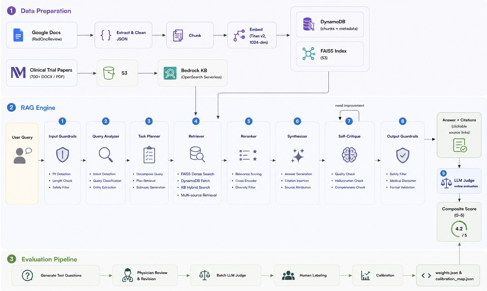

# RadOncReview Agentic RAG

## Introduction

Radiation oncology treatment decisions are grounded in a rapidly evolving body of clinical evidence — hundreds of trials, institutional guidelines, and disease-site protocols that are difficult to synthesize quickly at the point of care. Clinicians need fast, reliable access to this evidence to support treatment planning and patient communication, yet existing tools rarely integrate structured guidelines with primary trial literature in a unified interface.

This project presents an agentic RAG system designed specifically for radiation oncology clinical decision support. It retrieves from two complementary sources: curated treatment guidelines from [RadOncReview](https://www.radoncreview.org/) and 700+ clinical trial papers from Northwestern Medicine, delivering answers grounded in authoritative evidence with full source citations. The system adapts its retrieval strategy to query complexity, applies cross-encoder reranking, and evaluates every response with a multi-agent LLM judge calibrated against human labels. Key capabilities include evidence-grounded answers with clickable source links, live quality scoring via a calibrated composite score, and abstention when evidence is insufficient.

---

## System Overview

### Pipeline Architecture



### Two modes

| | Local | AWS App Runner |
|---|---|---|
| How to run | `python chat.py` (CLI) or `python api.py` (browser) | Auto-deployed from GitHub repo |
| AWS auth | SSO profile (`.env`) | IAM role |
| Intended for | Development / evaluation | Physician-facing clinical use |

---

## Demo

**Entering a query and receiving an answer:**

<!-- GIF: query input → answer with citations -->

**Clicking a source link:**

<!-- GIF: source citation → opens linked document -->

**Composite score breakdown:**

<!-- GIF: composite score panel expanding -->

---

## Setup & Replication

### Step 1 — Clone the repo and set up a virtual environment

```bash
git clone https://github.com/akiqiu8/RadOncReview-AgenticRAG.git
cd RadOncReview-AgenticRAG

python -m venv venv
source venv/bin/activate        # Windows: venv\Scripts\activate
pip install -r requirements.txt
```

### Step 2 — Google Docs API

The data preparation pipeline pulls treatment guidelines directly from Google Docs (source: [RadOncReview](https://www.radoncreview.org/)).

Follow the setup guide: [`data_prep/setup-guides/GoogleDocsAPI-setup.pdf`](data_prep/setup-guides/GoogleDocsAPI-setup.pdf)

This produces two credential files — place both inside `data_prep/`:
- `credentials.json` — OAuth2 client credentials from Google Cloud Console
- `token.json` — generated automatically on first run via browser OAuth flow

### Step 3 — AWS CLI and SSO

Follow the setup guide: [`data_prep/setup-guides/AWS-CLI-setup.pdf`](data_prep/setup-guides/AWS-CLI-setup.pdf)

Configure your SSO profile (first time only):
```bash
aws configure sso --profile <your-profile>
```

Log in before each session:
```bash
aws sso login --profile <your-profile>
```

You will need access to: **S3**, **DynamoDB**, **Bedrock** (Knowledge Base + LLM models), and **AWS App Runner**.

### Step 4 — Configure environment variables

```bash
cp env_example .env
```

Open `.env` and fill in your values:

| Variable | Description |
|----------|-------------|
| `AWS_PROFILE_NAME` | Your SSO profile name (local only — leave empty on App Runner) |
| `AWS_REGION` | AWS region where your resources are deployed |
| `S3_BUCKET_NAME` | S3 bucket storing the FAISS index |
| `DYNAMODB_TABLE_NAME` | DynamoDB table storing document chunks |
| `KB_ID` \* | Bedrock Knowledge Base ID |
| `KB_DATASOURCE_ID` \* | Bedrock Knowledge Base Data Source ID |

> \* Optional — required only if using the clinical trials source stored in Bedrock KB (see Step 6)

### Step 5 — Run the data preparation pipeline

This populates S3, DynamoDB, and builds the FAISS index from RadOncReview guideline documents. Run once, or re-run whenever source documents are updated.

```bash
python data_prep/main.py
```

This will:
1. Pull treatment guideline documents from Google Docs
2. Clean and chunk the text
3. Generate embeddings (Amazon Titan)
4. Upload chunks to DynamoDB
5. Build and upload the FAISS index to S3

### Step 6 — (Optional) Set up Bedrock Knowledge Base for clinical trials

This step is **optional**. The RAG system runs without it — you simply lose the clinical trial paper retrieval source.

If you have clinical trial documents (PDF, DOCX, scanned PDF, etc.):

1. Go to **AWS Console → Amazon Bedrock → Knowledge Bases**
2. Click **Create knowledge base**
3. Under **Data source**, select S3 — upload your documents to a dedicated S3 prefix (e.g. `s3://your-bucket/reading-lists/`)
4. For parsing, select **Amazon Nova Pro** as the foundation model parser (recommended for scanned PDFs and DOCX)
5. For chunking strategy, select **Fixed-size** (or other) and adjust token size & overlap based on your LLM's context window
6. For the vector store, select **OpenSearch Serverless**
7. Complete setup and click **Sync**
8. Copy the **Knowledge Base ID** and **Data Source ID** → add to `.env` as `KB_ID` and `KB_DATASOURCE_ID`

> This project indexes 700+ clinical trial papers organized by disease site (DOCX, PDF, scanned PDF).

### Step 7 — Run locally

**CLI interface:**
```bash
python chat.py
```

**Browser interface (localhost:8000):**
```bash
python api.py
```

Then open `http://localhost:8000` in your browser.

### (Optional) Deploy to AWS App Runner

App Runner runs `api.py` as a containerized web service with a public URL.

1. Connect your GitHub repo in the App Runner Console
2. Set the following **Runtime environment variables** in Console → Configuration → Edit:

| Variable | Value |
|----------|-------|
| `AWS_PROFILE_NAME` | none |
| `AWS_REGION` | your region |
| `S3_BUCKET_NAME` | your bucket |
| `DYNAMODB_TABLE_NAME` | your table |
| `KB_ID` | your KB ID |
| `KB_DATASOURCE_ID` | your datasource ID |

Set `AWS_PROFILE_NAME` to `none` (or leave it unset) — App Runner uses the attached IAM role automatically.

> **Note:** If any value changes, update it in **both** `.env` (local) and App Runner Console (deployed).

> **Note:** AWS App Runner is no longer accepting new customers as of April 30, 2026. Existing services continue to run. For new deployments consider AWS ECS/Fargate.

---

## Components

### 1. Data Preparation (`data_prep/`)

Pulls treatment guidelines from [RadOncReview](https://www.radoncreview.org/) Google Docs, processes them into chunks, generates embeddings, and stores everything in AWS:

```
Google Docs → extract → clean → chunk → embed (Titan) → DynamoDB + FAISS (S3)
```

| Setting | Value |
|---------|-------|
| Embedding model | `amazon.titan-embed-text-v2:0` (1024-dim) |
| Chunk size | 300 tokens, 45-token overlap |
| Vector store | FAISS index stored in S3, metadata in DynamoDB |

Clinical trial papers (700+, including DOCX and scanned PDF) are separately uploaded to S3 and indexed via Bedrock Knowledge Base (see Step 6).

### 2. RAG Engine (`core/`)

`core/agent.py` orchestrates every step below. Each query goes through a multi-step agentic pipeline:

| Step | Component | Model / Config | Description |
|------|-----------|----------------|-------------|
| 1 | Input Guardrails | — | PHI detection, input length validation |
| 2 | Query Analyzer | `meta.llama3-70b-instruct-v1:0` | Intent classification, disease category, treatment modality extraction |
| 3 | Task Planner | `meta.llama3-70b-instruct-v1:0` | Query decomposition, retrieval strategy selection |
| 4 | Retriever | FAISS + DynamoDB + Bedrock KB |  FAISS: dense search; KB: hybrid search. top-6 FAISS & top-10 KB per topic| 
| 5 | Reranker | `BAAI/bge-reranker-base` (cross-encoder) | Rerank to top-5 (simple) or top-3 per topic (complex/comparison) |
| 6 | Synthesizer | `meta.llama3-70b-instruct-v1:0` | Response generation with inline citations |
| 7 | Self-Critique | `meta.llama3-70b-instruct-v1:0` | Evaluates completeness, accuracy, safety — retries if needed |
| 8 | Output Guardrails | — | Safety verification, disclaimer injection |
| 9 | LLM Judge v3 (`evaluation/llm_judge_v3.py`) | `us.amazon.nova-pro-v1:0` | **Online** evaluation after each response: retrieval adequacy, abstention, faithfulness, correctness, answer quality — composite score shown in chat |

### 3. Evaluation Pipeline (`evaluation/`, `calibration/`, `scripts/`)

The LLM judge operates in two modes: **offline** (batch evaluation on a labeled test set, used to calibrate the score and compute composite) and **online** (called automatically by the RAG engine after each response, as shown in Step 9 above). **The offline pipeline must be run first**: the online composite score depends on `calibration/weights.json` and `calibration/calibration_map.json` generated by the offline pipeline.

```
Generate questions → LLM judge (batch) → Human labels → Calibration → Weights
```

**Step 1 — Generate test questions**
```bash
python scripts/generate_test_questions.py
# Output: test_questions.csv
```

Uses `us.amazon.nova-pro-v1:0` to generate clinically realistic QA pairs from KB-retrieved chunks, organized by disease site and 5 clinical topics (outcomes, dose/fractionation, toxicity, trial comparison, patient selection). **Need physicians to review and revise the generated questions & expected answers before proceeding**.

**Step 2 — Run batch LLM evaluation**
```bash
python evaluation/llm_judge_v3.py --excel <your-excel>.xlsx
# Output: eval_results/<disease_site>.csv

# To evaluate by disease site (recommended to avoid partial failures on large sets):
python evaluation/llm_judge_v3.py --excel <your-excel>.xlsx --sheet Breast
```

Five specialized judge agents (`us.amazon.nova-pro-v1:0`) score each answer across six criteria (Correctness evaluated in two variants):

| Criterion | Scale | What it evaluates |
|-----------|-------|-------------------|
| Retrieval Adequacy | 1–5 | Are the retrieved chunks sufficient to answer the question? |
| Abstention | Yes / No | Should the system have abstained (evidence insufficient)? |
| Faithfulness | 1–5 | Is the answer grounded in retrieved documents, with no hallucination? |
| Correctness A | 1–5 | How well does the answer match the expected reference answer? *(batch eval only)* |
| Correctness B | 1–5 | Is the conclusion aligned with the retrieved documents? *(RAG proxy — used live)* |
| Answer Quality | 1–5 | Clarity, completeness, and clinical usefulness of the answer |

**Step 3 — Physician review & labeling (Human-in-the-loop)**

Have a physician open the output Excel file and fill in human scores for the Correctness and Answer Quality columns. Clinical expertise is required to assess answer accuracy against ground truth.

**Step 4 — Calibration**
```bash
python calibration/calibration.py --excel <your-excel>.xlsx
# Outputs:
#   calibration/calibration_map.json  — isotonic regression lookup per criterion
#   calibration/weights.json          — Spearman-derived criterion weights
#   calibration/combined_eval.csv     — all rows with raw + calibrated scores
```
Fits **Isotonic Regression** (scikit-learn) on Correctness B and Answer Quality to align LLM scores with human labels. Then computes **Spearman correlation** between each criterion and human correctness scores to derive normalized weights.

**Composite score (live, shown in chat):**

```
composite = Σ weight[k] × calibrated_score[k]
            for k in {retrieval_adequacy, faithfulness, correctness_b, answer_quality}
```

- Correctness B and Answer Quality use calibrated scores via isotonic lookup
- Retrieval Adequacy and Faithfulness use raw scores
- **Abstention gate:** if the Abstention judge determines the system should not have answered, composite = 0 regardless of other scores

**Live output shown in chat:**

| Output | Description |
|--------|-------------|
| Latency | End-to-end response time |
| Sources | Citations with clickable document links |
| Reasoning trace | Step-by-step agent log |
| Composite score | Weighted calibrated score (0–5); 0 if abstention triggered |

---

## Project Structure

```
RadOncReview-AgenticRAG/
├── config.py                      # Configuration (AWS, LLM, retrieval params)
├── chat.py                        # Interactive CLI chat interface
├── api.py                         # REST API server (FastAPI)
├── requirements.txt               # Dependencies
├── env_example                    # Environment variable template (copy to .env)
│
├── static/
│   └── index.html                 # Web frontend (served by api.py)
│
├── core/                          
│   ├── agent.py                   # RAG main orchestrator
│   ├── models.py                  # Data models
│   ├── llm_client.py              # AWS Bedrock LLM client
│   ├── query_analyzer.py          # Intent classification & entity extraction
│   ├── task_planner.py            # Query decomposition & retrieval strategy
│   ├── retriever.py               # FAISS + DynamoDB + Bedrock KB + reranking
│   ├── synthesizer.py             # Response generation & self-critique
│   └── guardrails.py              # Input/output safety checks
│
├── evaluation/                    
│   ├── llm_judge_v3.py            # Multi-agent LLM judge (Current)
│   ├── llm_judge_v2.py            # Previous version
│   └── llm_judge.py               # Previous version
│
├── calibration/
│   ├── calibration.py             # Isotonic regression + Spearman weights
│   ├── calibration_map.json       # Generated by calibration.py
│   └── weights.json               # Generated by calibration.py
│
├── scripts/
│   ├── generate_test_questions.py # Generate QA pairs from KB via Nova Pro
│   ├── check_available_models.py  # Detect available Bedrock models
│   └── demo.py                    # Test (mock mode, no AWS required)
│
└── data_prep/                     
    ├── main.py                    # One-time data ingestion pipeline
    ├── extract_doc_json.py        # Pull raw JSON from Google Docs API
    ├── clean_json.py              # Format into hierarchical sections
    ├── flattening_chunking.py     # Flatten + sentence-level chunking
    ├── embedding.py               # Generate embeddings + build FAISS index
    ├── DynamoDB_store_load.py     # Upload/load chunks to/from DynamoDB
    ├── s3_store_load.py           # Upload/load files to/from S3
    ├── helper.py                  # Utility functions
    └── setup-guides/
        ├── GoogleDocsAPI-setup.pdf
        └── AWS-CLI-setup.pdf
```

---

## Troubleshooting

**AWS connection error (local)**
```bash
aws sso login --profile $AWS_PROFILE_NAME
```

**Bedrock model access denied**
```bash
python scripts/check_available_models.py
```
Then edit `LLMConfig.model_id` in `config.py` to a model available in your account.

**No results returned**
- Confirm `python data_prep/main.py` has been run
- Verify the DynamoDB table has data and the FAISS index exists in S3

**Composite score missing in chat (FileNotFoundError)**
```bash
python calibration/calibration.py --excel <your-excel>.xlsx
```

---

## Contributors

- Rachel Gong
- Mu He
- Shan Zhong
